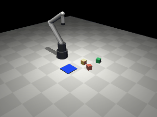
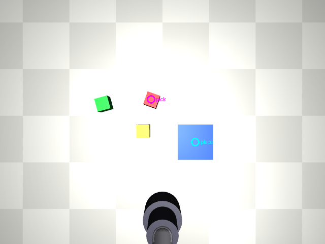

# robot-manipulation

Exploring how to drive a robot arm with AI: you give an instruction in plain words, a model looks at a camera image and decides what to do, and the arm does it.



Today this runs entirely in simulation, on a laptop, for free. The [build plan](docs/BUILD_PLAN.md) describes how it moves to cloud AI models, a remote real robot reached over the internet, and then a robot on your own desk. The [landscape](docs/LANDSCAPE.md) covers what Google DeepMind, Mistral, NVIDIA and others have released, and which of it we use.

## The idea in one picture

```
   camera image + "Put the red cube on the blue tray."
                    │
                    ▼
   ┌──────────── BRAIN (brains.py) ─────────────┐
   │ points at things in the image:              │   swappable:
   │   pick = [y, x]   place = [y, x]            │   colour finder (offline),
   └─────────────────────────────────────────────┘   Gemini Robotics-ER, Mistral
                    │  two points, 0-1000 image coordinates
                    ▼
   ┌──────────── BODY (sim.py) ─────────────────┐
   │ pixel → 3D point     (depth ray from camera)│   today: MuJoCo simulation
   │ 3D point → joints    (inverse kinematics)   │   later: a real arm, same
   │ joints → motion      (smooth trajectory)    │   interface
   └─────────────────────────────────────────────┘
```

The brain never sees joints or metres, and the body never sees words. Each side can be replaced without touching the other: a better model, or a real arm instead of the simulated one. This split (a vision-language model that *points*, plus classic robotics that *moves*) is the approach Google DeepMind documents for Gemini Robotics-ER. It is the cheapest way to get a working system. The alternative, a single end-to-end "vision-language-action" model such as NVIDIA GR00T or Physical Intelligence's π0.5, comes later in the plan.

What the brain saw, and where it pointed:



## Run it

You need Python 3.10 or newer.

```bash
python -m venv .venv && source .venv/bin/activate
pip install -e '.[dev]'

python -m robot_manipulation.run                    # one episode, offline colour brain
python -m robot_manipulation.run --episodes 20      # success rate over 20 random scenes
python -m robot_manipulation.run --seed 3 --gif     # also save a video in out/
pytest                                              # 19 tests, about 3 seconds
```

The `out/` folder gets, for each episode, the camera image with the brain's two points drawn on it, plus a GIF with `--gif`.

### Use a real AI brain

```bash
export GEMINI_API_KEY=...      # from https://aistudio.google.com/apikey
python -m robot_manipulation.run --brain gemini --episodes 10

export MISTRAL_API_KEY=...     # from https://console.mistral.ai
python -m robot_manipulation.run --brain mistral --episodes 10
```

`--model` overrides the model id (defaults: `gemini-robotics-er-2-preview`, `mistral-medium-latest`). With an AI brain you can also give instructions the colour finder could never follow, for example `--instruction "Put the cube closest to the robot on the tray."`.

## What is simplified, honestly

- **The arm is kinematic.** We set its joint angles directly, as if it had a perfect motor controller. Only the cubes obey physics. Real arms lag, overshoot and carry a payload limit.
- **The gripper is a suction cup.** Touching a cube's top face attaches it. A two-finger gripper must also choose a grasp angle, which is a step for later.
- **Depth is perfect.** A ray from the camera gives the exact 3D point under a pixel. A real depth camera is noisy at the edges of objects.
- **The offline colour brain only understands colour words.** It is a baseline that shows the pipeline works, not intelligence.

## Files

| Path | What it is |
|---|---|
| `robot_manipulation/sim.py` | The body: scene, camera geometry, inverse kinematics, pick and place |
| `robot_manipulation/brains.py` | The brains: colour finder, Gemini, Mistral, and the shared answer format |
| `robot_manipulation/run.py` | The sense → think → act loop and the command line |
| `robot_manipulation/assets/desk_arm.xml` | The MuJoCo model: a 4-joint arm, three cubes, a tray, two cameras |
| `tests/` | Kinematics, camera geometry, end-to-end runs, API request formats |
| `docs/BUILD_PLAN.md` | Phases, costs and decision points |
| `docs/LANDSCAPE.md` | Survey of models, simulators and remote robots, with sources |

## Contributing convention

Every commit is co-authored by Renan and Claude: Renan is the git author, and Claude appears as `Co-Authored-By`. Run `git config core.hooksPath .githooks` once after cloning and the hook adds the Claude line to your own commits automatically. Details in [CLAUDE.md](CLAUDE.md).
